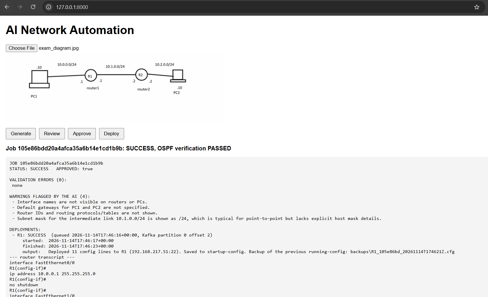
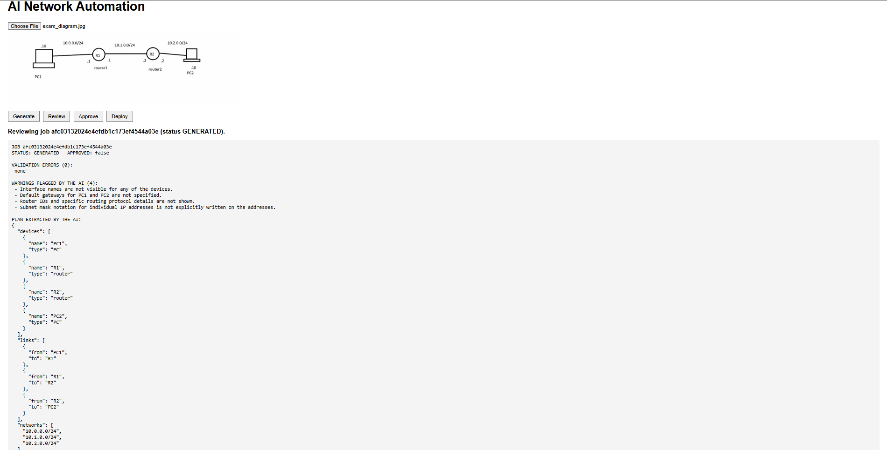
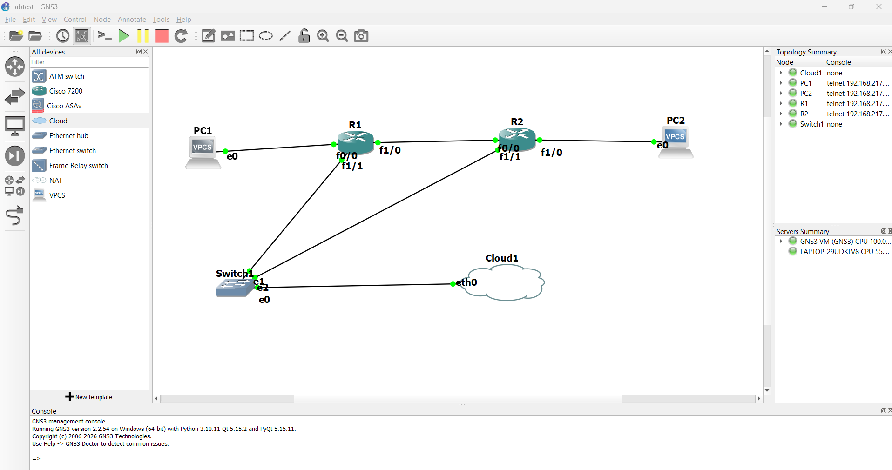
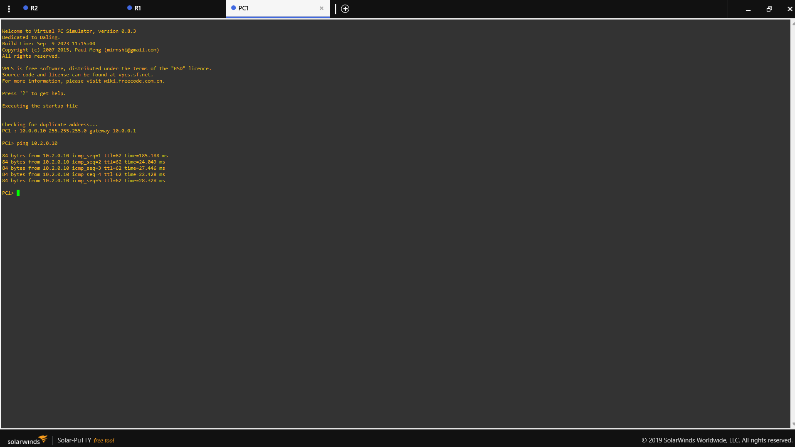

# AI-Driven Network Automation

Upload a network diagram, and this system turns it into a **verified OSPF deployment on real Cisco routers**: an image-capable AI reads the topology, the backend validates it and generates Cisco IOS configs, an administrator approves them, and a Kafka-driven worker pushes them over SSH and proves OSPF works.

> Built for a university network-automation lab exam. The AI never touches a router: nothing is deployed without explicit human approval.



## Highlights

- **Diagram to config.** A Gemini vision model extracts devices, links, subnets and IPs from a PNG/JPG as structured JSON, and flags anything unclear instead of guessing.
- **Validation before anything is sent.** Addresses, subnet consistency, interface mapping, router IDs and OSPF settings are checked, and invalid jobs cannot be approved.
- **Human-in-the-loop.** Configs are shown for review. An administrator must click Approve, and the worker re-checks approval with the backend before touching a router.
- **Event-driven deployment.** Approved jobs become one Kafka message per router. A Python worker claims each job so it never runs twice.
- **Safe SSH deployment (Paramiko).** Backs up the running config first, refuses lines that could lock out management access or wipe the router, saves to startup-config, and reports clear errors for bad logins and timeouts.
- **Automatic OSPF verification.** After the last router, it runs `show ip ospf neighbor`, `show ip route ospf` and `show ip protocols`, and checks for FULL adjacency and that each router learns the other LAN through OSPF.
- **Live job monitor.** A web UI shows PENDING, RUNNING, SUCCESS and FAILED per router, with timestamps, deployment output and verification checks.

## How it works

```
 Browser (frontend/index.html)
        |  upload, Generate, Review, Approve, Deploy
        v
 FastAPI backend (backend/app.py)
   analysis.py   image -> JSON plan (Gemini; no router access)
   planning.py   cleans up the plan
   validator.py  checks addresses, IDs, links, management hosts
   generator.py  Cisco IOS config from the plan + configs/devices.yaml
   dispatcher.py approved job -> Kafka topic network-config-jobs
        |
        v
 Kafka  (one message per device)
        |
        v
 Worker (worker/worker.py)
   1. claims the device job (blocks duplicates)
   2. re-checks approval and fetches the config
   3. deployer.py: backup, push over SSH (Paramiko), write memory
   4. reports SUCCESS / FAILED with output
   5. verifier.py: OSPF checks once every router is done
        |
        v
 R1 and R2 (GNS3, Cisco 7200, IOS 15.2)
```

## The lab

```
PC1 10.0.0.10/24 --- R1 (1.1.1.1) --- R2 (2.2.2.2) --- PC2 10.2.0.10/24
     gw 10.0.0.1     f0/0   f1/0   f0/0   f1/0     gw 10.2.0.2
```

OSPFv2, process 1, area 0. The LAN-facing interfaces are passive, and no static routes are used. Management SSH runs on `FastEthernet1/1`, outside the OSPF design.

| Evidence | |
|---|---|
|  | AI-extracted plan as JSON |
|  | The GNS3 lab |
|  | PC1 pings PC2 after automatic deployment |

The full write-up with architecture, security design and test evidence is in [docs/REPORT.md](docs/REPORT.md).

## Tech stack

Python 3.11+, FastAPI + Uvicorn, Apache Kafka (KRaft, single node), kafka-python, Paramiko, Google Gemini (`google-genai`), PyYAML, Pillow, plain HTML/CSS/JavaScript (no build step), GNS3 with Cisco IOS 15.2 (7200) and a fake-IOS SSH server for tests.

## Quick start

Prerequisites: Python 3.11+, Kafka (Docker or a local install), and a GNS3 lab with two Cisco routers (the IOS image is **not** included).

```bash
python -m venv .venv
.venv\Scripts\activate
python -m pip install -r requirements.txt
copy .env.example .env
copy configs\devices.example.yaml configs\devices.yaml
```

Then:

1. **Edit `.env`**: set `GEMINI_API_KEY` (get one at Google AI Studio), `SSH_USERNAME`, `SSH_PASSWORD` (or `SSH_KEY_PATH`), and `MGMT_INTERFACES=FastEthernet1/1`.
2. **Edit `configs/devices.yaml`**: the routers' management IPs and the real interface names from `show ip interface brief`.
3. **Start Kafka** and create the topic:

   ```bash
   docker compose up -d
   docker compose exec kafka /opt/kafka/bin/kafka-topics.sh --create --topic network-config-jobs --bootstrap-server localhost:9092
   ```

4. **Run the backend and the worker** (two terminals, project folder):

   ```bash
   python -m uvicorn backend.app:app --port 8000
   python -m worker.worker
   ```

5. Open **http://127.0.0.1:8000**, upload a diagram, then **Generate, Approve, Deploy**.

Set `DRY_RUN=1` in `.env` to run the whole flow without sending anything to the routers.

> **Windows tip:** keep the project in a short path. Very long folder paths can break imports (260-character limit).

## Tests

Run from the project folder. They use a fake Cisco SSH server, so no real router is needed (the last two also need Kafka running):

```bash
python tests\check_plan.py
python tests\check_ssh_deploy.py
python tests\check_ospf_verify.py
python tests\check_worker.py
python tests\check_end_to_end.py
```

## Security design

- No passwords, API keys or private keys in code or configs. Secrets live in `.env` (git-ignored) or an SSH key file.
- Nothing is deployed without administrator approval, and the worker re-checks it.
- The deployer refuses commands that could disable management SSH or wipe a router, and every deployment keeps a backup of the previous running config as a recovery path.
- The AI only reads the diagram. It has no router access.
- SSH host keys are remembered, and a changed key is refused.

## Project layout

```
backend/    FastAPI app: upload, AI analysis, validation, approval, Kafka producer
worker/     Kafka consumer, Paramiko deployment, OSPF verification
frontend/   Web UI (single HTML file)
configs/    devices.example.yaml (copy to devices.yaml, which is git-ignored)
docs/       REPORT.md and screenshots
tests/      Automated checks with a fake Cisco SSH server
test_images/ Sample diagram
docker-compose.yml   Single-node Kafka
.env.example         Environment template
```

## Limitations

- Built and tested on a two-router OSPF lab (Cisco 7200, IOS 15.2) in GNS3.
- Interface names, router IDs and management IPs are not on the diagram, so they come from `configs/devices.yaml`.
- Paramiko is pinned to 3.x so it can talk to old IOS SSH algorithms.

## License

MIT. See [LICENSE](LICENSE).
